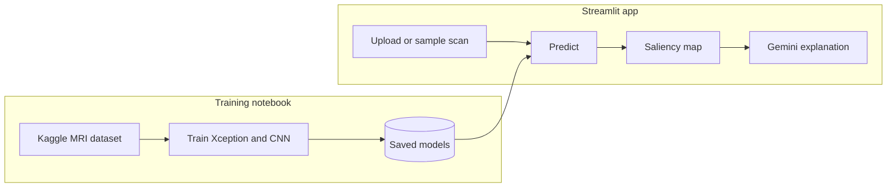

# Brain Tumor MRI Classifier

A Streamlit app that classifies a brain MRI image as glioma, meningioma, pituitary tumor or no tumor. It also shows which part of the image influenced the prediction and can explain it in plain language using Gemini.

## Results

Two models were trained on the same data and tested on 800 images (200 per class) that were not used during training.

| Model | Input size | Test accuracy |
| --- | --- | --- |
| Xception (transfer learning) | 299 × 299 | 94.13% |
| Custom CNN (trained from scratch) | 224 × 224 | 86.12% |

Starting from a model pre-trained on ImageNet beat training from scratch by about 8 points.

## How it works



- **Data:** [Brain Tumor MRI Dataset](https://www.kaggle.com/datasets/masoudnickparvar/brain-tumor-mri-dataset) on Kaggle, 7,200 images. 5,600 for training, 800 for validation, 800 for testing.
- **Training:** `brain-tumor-classification-notebook.ipynb`, run on [Kaggle](https://www.kaggle.com/code/sushmitha047/brain-tumor-classification-notebook) with a free GPU.
- **Saliency map:** highlights the pixels that changed the prediction the most (red = strongest).
- **Explanation:** Gemini describes the highlighted regions in a few sentences.

The app has three pages: **Classify**, **Compare models** and **How it works**.

## Run it locally

You need Python 3.12, [Poetry](https://python-poetry.org/) and [Git LFS](https://git-lfs.com/) (the model files are stored with Git LFS).

```bash
git clone https://github.com/sushmitha047/brain-tumor-classification.git
cd brain-tumor-classification
git lfs pull
poetry install
```

Create a file named `.env` in the project folder and add your Google AI Studio API key:

```
GOOGLE_API_KEY=your_key_here
```

Then start the app:

```bash
poetry run streamlit run streamlit-app/frontend_streamlit.py
```

The API key is only needed for the explanation feature. Classification and saliency maps work without it.

## Project structure

```
├── brain-tumor-classification-notebook.ipynb   # training and evaluation
├── models/            # trained models
├── src/               # model loading, prediction, saliency map, Gemini
├── streamlit-app/     # the app pages
└── assets/            # sample scans and confusion matrices
```

## Limitations

- Trained and tested on one public dataset, so results on scans from other hospitals may be lower.
- Works on single 2D slices, not full 3D scans.
- This is a learning project, not a medical tool.

## Next steps

- Turn the notebook into a pipeline with DVC and track experiments with MLflow.
- Serve the model with FastAPI, package it with Docker and deploy it with GitHub Actions.

## Acknowledgements

Dataset by Masoud Nickparvar on Kaggle (CC0).
